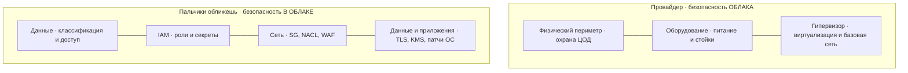
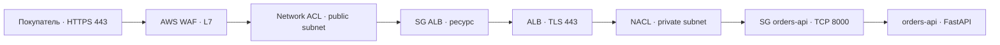
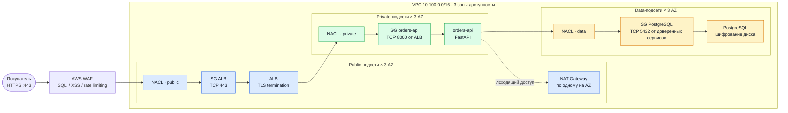

# Лаба 7 — Безопасность облачной инфраструктуры

## 1. Исходные данные и принятые решения

В предыдущих работах спроектирована VPC `10.100.0.0/16`, распределённая между тремя зонами доступности. В каждой зоне есть public, private и data-подсети. В публичных подсетях находятся ALB и NAT Gateway, в приватных — frontend, `orders-api` (FastAPI, порт `8000`), логистика и платежи, в data — PostgreSQL, Redis, Kafka и MinIO. `orders-api` и стек мониторинга фактически подняты на домашнем сервере в Docker Compose.

Выбрана **целевая модель AWS**, поскольку в сетевой архитектуре фигурируют VPC, ALB, Security Groups и NAT Gateway. IAM, Secrets Manager, KMS и AWS WAF ниже — **проектные решения**, не подтверждённые реальной конфигурацией AWS.

Классификация данных магазина:

| Класс | Примеры | Требуемая защита |
|---|---|---|
| Публичные | фотографии фруктов, описания товаров | Контролируемая публикация через CDN, защита от подмены |
| Внутренние | ассортимент, отчёты склада, конфигурация сервисов | IAM, аудит, шифрование |
| Конфиденциальные | заказы, адреса покупателей, номера телефонов, учётные записи | TLS, минимальные права, шифрование, резервное копирование |
| Секретные | пароли PostgreSQL, токены платежей, ключи интеграций | Secrets Manager / Vault, ротация, запрет хранения в Git |

## 2. Этап 1 — Shared Responsibility

### 2.1. Диаграмма разделения ответственности



Диаграмма Mermaid приведена полностью выше, без необходимости открывать отдельный файл. Граница ответственности для IaaS условно проходит по **гипервизору**: провайдер защищает физическую платформу и гипервизор, клиент отвечает за гостевую ОС EC2, данные, приложения и конфигурации. Для управляемых сервисов граница смещается — обслуживанием ОС и СУБД занимается провайдер.

### 2.2. Ответственность по моделям обслуживания

| Модель | Сервис | Провайдер отвечает за | Клиент отвечает за |
|---|---|---|---|
| IaaS | Amazon EC2 | ЦОД, оборудование, физическую сеть, гипервизор | Гостевую ОС, обновления, сетевые правила, приложение, доступ к данным |
| PaaS (управляемая БД) | Amazon RDS for PostgreSQL | Базовую инфраструктуру, ОС и работу управляемого движка/службы | Данные, схемы, настройки доступа, параметры СУБД, резервное копирование в рамках доступных настроек |
| SaaS | Microsoft 365 (Office 365) | Приложение, платформу и инфраструктуру | Аккаунты, MFA, политики доступа, классификацию и размещаемые данные |

**Ответственность за собственные данные остаётся у клиента** независимо от модели обслуживания; часть технических мер может выполняться провайдером по договору.

### 2.3. Кейс: утечка PostgreSQL через открытую SG

Если команда ошибочно разместила PostgreSQL в публичной подсети и разрешила `TCP/5432` от `0.0.0.0/0`, за ошибку конфигурации и утечку отвечает клиент — оператор интернет-магазина. Провайдер обязан защищать свою платформу, но не выбирает за клиента правила Security Group. Для предотвращения: БД находится в data-подсетях без публичного IP, входящий `5432` разрешён только от доверенных SG приложений, а события доступа и сетевые потоки проверяются аудитом.

## 3. Этап 2 — Identity and Access Management (IAM)

### 3.1. Учебная политика минимальных прав для резервной копии

По условию задания выбраны **фиксированный бакет** `my-backup-bucket`, **диапазон** `10.0.0.0/24`, только `s3:PutObject` и `s3:GetObject`, запрет удаления. В целях соблюдения требования «без `*` в Resource» доступ ограничен **одним объектным ключом** `orders-api/latest.sql.gz`. Для динамических имён бэкапов потребовался бы отдельный согласованный набор ARN или префикс с `/*`.

Для частного IP через S3 VPC endpoint используется `aws:VpcSourceIp`, **а не** `aws:SourceIp`. Чтобы исключить совпадающие частные диапазоны из чужих VPC, дополнительно ограничен `aws:SourceVpce`. Указанный `vpce-0123456789abcdef0` — **пример идентификатора**, его необходимо заменить реальным при развёртывании.

```json
{
  "Version": "2012-10-17",
  "Statement": [
    {
      "Sid": "AllowReadAndWriteOnlyBackupObjectViaVpcEndpoint",
      "Effect": "Allow",
      "Action": ["s3:PutObject", "s3:GetObject"],
      "Resource": "arn:aws:s3:::my-backup-bucket/orders-api/latest.sql.gz",
      "Condition": {
        "IpAddress": {"aws:VpcSourceIp": "10.0.0.0/24"},
        "StringEquals": {"aws:SourceVpce": "vpce-0123456789abcdef0"}
      }
    },
    {
      "Sid": "ExplicitDenyDeleteBackupObject",
      "Effect": "Deny",
      "Action": ["s3:DeleteObject", "s3:DeleteObjectVersion"],
      "Resource": "arn:aws:s3:::my-backup-bucket/orders-api/latest.sql.gz"
    }
  ]
}
```

Это **identity-based policy** для роли, принимаемой сервисом резервного копирования, поэтому поле `Principal` отсутствует.

### 3.2. IAM User, сервисный аккаунт и роль

| Сущность | Кто использует | Аутентификация / способ получения доступа |
|---|---|---|
| IAM User | Человек либо устаревшая интеграция, когда федерация недоступна | Пароль/MFA для консоли или ключи доступа; для людей предпочтительна федерация через IAM Identity Center |
| Сервисный аккаунт | Не-человеческая идентичность для `orders-api`, backup job или CI | В AWS обычно **роль IAM** с временными учётными данными через instance profile, task role, IRSA/Pod Identity или OIDC |
| IAM Role | Делегируемый набор разрешений для сервиса или пользователя | Получает временные credentials через STS `AssumeRole` после проверки trust policy |

### 3.3. Принцип least privilege

Принцип минимальных привилегий означает, что субъект получает только нужные действия над конкретными ресурсами и только на необходимое время. **Правильно:** CI job может публиковать объект в `my-backup-bucket/orders-api/latest.sql.gz` по `s3:PutObject`, получает временные credentials и не может удалять данные. **Плохо:** назначить ему `AdministratorAccess`, `s3:*` ко всем бакетам и долгоживущий ключ в `.gitlab-ci.yml`.

### 3.4. Пять типичных ошибок IAM

| Ошибка | Последствие | Предотвращение |
|---|---|---|
| Политика `Action: "*"`, `Resource: "*"` | Компрометация одного сервиса даёт контроль над облаком | Перечень конкретных действий и ARN; IAM Access Analyzer |
| Постоянное использование root | Полный компромисс аккаунта при краже учётных данных | Root только для исключительных задач, MFA, регулярный аудит |
| Долгоживущие access keys в Git или CI-переменных без контроля | Утечка позволяет злоумышленнику обращаться к API | IAM Role + STS/OIDC, ротация при инциденте, secret scanning |
| Общая учётная запись администратора | Нельзя установить автора изменений | Индивидуальные учётные записи, федерация, CloudTrail |
| Отсутствие MFA и пересмотра разрешений | Взлом учётки или накопление излишних прав | MFA, регулярный access review, удаление неиспользуемых разрешений |

## 4. Этап 3 — Secrets Management

### 4.1. Сравнение HashiCorp Vault и AWS Secrets Manager

| Критерий | HashiCorp Vault | AWS Secrets Manager |
|---|---|---|
| Платформа | Self-hosted / мультиоблачная | Управляемый сервис AWS |
| Динамические секреты с TTL | Да: в т. ч. временные пользователи БД через secrets engines | Обычно хранение/ротация секретов; временные AWS credentials выдаются через STS, не самим Secrets Manager |
| Автоматическая ротация | Политики TTL, lease и интеграция с внешними системами | Rotation schedules и интеграция с Lambda / поддерживаемыми сервисами |
| Unseal и сопровождение | Нужно организовать unseal/auto-unseal, HA, обновления и бэкапы | Инфраструктура сервиса управляется AWS |
| Стоимость/администрирование | Операционные затраты на инфраструктуру, сопровождение и возможную лицензию | Оплата за секреты и API-вызовы; меньше операционной работы |
| IAM | Собственные политики и auth methods, возможна AWS IAM auth | Нативная интеграция с IAM и CloudTrail |

**Выбор:** для чисто AWS-среды магазина целесообразен AWS Secrets Manager. Для домашнего сервера и мультиоблачных интеграций — Vault, но только при готовности поддерживать его надёжность, политики и процедуру восстановления. Это варианты для разных окружений, а не утверждение о текущем развёртывании.

### 4.2. Чек-лист обращения с секретами

- [ ] **<u>Никогда не хранить пароли, токены и приватные ключи в исходном коде, `.env` в Git, Dockerfile и истории коммитов.</u>**
- [ ] Получать секреты в рантайме из менеджера через сервисную роль и минимальные разрешения.
- [ ] Использовать TLS, KMS-шифрование и ограниченный доступ к секретам по IAM и сети.
- [ ] Настроить автоматическую ротацию по регламенту, проверить, что приложение подхватывает новое значение.
- [ ] Вести аудит чтения/изменения секретов, исключать их значения из логов и метрик.

### 4.3. Кейс: пароль prod-PostgreSQL попал в публичный Git

1. **Сразу ограничить последствия:** объявить инцидент; отозвать скомпрометированные доступы, закрыть излишние сетевые правила и проверить активные сессии.
2. Сгенерировать новый пароль/учётную запись для PostgreSQL; перевести приложения на новый секрет через Secrets Manager либо Vault; после переключения отозвать старую учётную запись. Для БД по возможности использовать отдельные роли с минимальными правами.
3. Проверить CloudTrail, логи PostgreSQL, сетевые потоки, события CI/CD и обращения к секрету на признаки злоупотреблений; оценить масштаб утечки и необходимость уведомлений.
4. Удалить секрет из текущего дерева Git и при необходимости переписать историю, но **не считать удаление заменой ротации**: копии истории могли сохраниться.
5. Включить secret scanning и pre-commit проверки, закрыть выдачу статических ключей, настроить периодические ревизии прав и учебные инцидентные тренировки.

## 5. Этап 4 — Шифрование данных и AWS KMS

### 5.1. In-transit и at-rest

**In-transit:** защита передаваемых данных от перехвата и подмены, например HTTPS/TLS 1.2/1.3 между браузером и ALB, TLS между `orders-api` и PostgreSQL (с проверкой сертификата). **At-rest:** защита уже записанных данных, например EBS-тома серверов и PostgreSQL с шифрованием через KMS, а также объекты и бэкапы в S3 с SSE-KMS.

### 5.2. Envelope encryption

AWS KMS создаёт **Data Key (DEK)** и возвращает его в открытой форме уполномоченному вызывающему сервису, а также зашифрованную копию DEK. Данные шифруются открытым DEK вне KMS, после чего открытый DEK удаляется из памяти, а зашифрованный DEK можно хранить рядом с шифротекстом. Ключ KMS (ранее CMK), которым защищён DEK, остаётся под управлением KMS; его необработанный ключевой материал не выдаётся приложению и защищается HSM. Для расшифровки сервис с необходимыми правами обращается в KMS за расшифровкой DEK.

### 5.3. Что и как шифруем

| Объект | Решение для целевой архитектуры | Сервис / контроль |
|---|---|---|
| Публичный HTTPS-трафик | TLS 1.2/1.3; сертификаты ACM; HTTPS listener на `:443` | AWS ALB (+ AWS WAF); Route 53 отвечает за DNS, **не терминирует TLS** |
| Внутренний API-трафик | TLS на внутренних соединениях, при необходимости mTLS | Frontend, `orders-api`, логистика/платежи |
| Диски ВМ | EBS encryption с AWS KMS, включая snapshot | EC2/EBS |
| Объекты статики и бэкапов | S3 Block Public Access, SSE-KMS и ограниченные bucket policies | S3 + KMS |
| PostgreSQL | TLS подключения; шифрование томов и snapshot с KMS | RDS PostgreSQL **или** EC2 + зашифрованный EBS (зависит от варианта развёртывания) |
| Бэкапы MinIO в домашней среде | Отдельная политика TLS, шифрования и ключей MinIO; **AWS KMS нельзя автоматически считать включённым** | MinIO, учебный контур |
| Секреты | Шифрование с помощью KMS, роли и аудит доступа | AWS Secrets Manager |

### 5.4. Ошибки шифрования

| Ошибка | Почему опасно |
|---|---|
| HTTPS только на внешнем ALB, а внутренние соединения без TLS | Трафик с данными заказов остаётся доступен для перехвата внутри сети при компрометации её узла |
| Отключённое at-rest шифрование дисков или бэкапов | Утечка снимка/носителя раскрывает данные |
| Самоподписанные/просроченные сертификаты без проверки цепочки | Клиенты могут принимать подменённого сервера и стать жертвой MITM |
| Общий KMS-ключ с чрезмерно широкими правами `kms:Decrypt` | Взлом одной роли позволяет расшифровать много наборов данных |

## 6. Этап 5 — Сетевая защита: Security Group, NACL, WAF

### 6.1. Разница между Security Group и NACL

| Свойство | Security Group | Network ACL |
|---|---|---|
| Область применения | ENI / ресурс (например, ALB, EC2, RDS) | Подсеть VPC |
| Stateful / Stateless | Stateful: ответный трафик разрешается автоматически | Stateless: нужны отдельные правила для обратного трафика |
| Тип правил | Только Allow | Allow и Deny |
| Порядок оценки | Все правила образуют набор разрешений | Порядок по номеру, первое совпадение |
| Использование | Узкие доверенные связи между сервисами | Дополнительная фильтрация сегментов и адресов |

### 6.2. Схема трёх уровней



Исходный код этой Mermaid-схемы приведён непосредственно в отчёте. Ниже показана расширенная схема безопасности с ALB, `orders-api` и PostgreSQL. Она заменяет отдельный SVG-файл, поэтому для просмотра схемы достаточно открыть `report.md`.

#### Расширенная схема безопасности интернет-магазина



Схема отображает **проектируемые** зоны безопасности. Повторение компонентов по трём AZ означает планируемое резервирование, а не подтверждает развёртывание нескольких экземпляров в AWS.

Диаграмма показывает **логический порядок контролей**, а не сетевой hop-by-hop захват пакетов: AWS WAF интегрирован с ALB и проверяет HTTP-запросы на уровне L7, NACL применяется на границах подсетей, SG — к сетевым интерфейсам. Для ALB, входящего в публичную подсеть, и приложения в приватной применяются разные SG и NACL.

### 6.3. Таблица подсетей и сетевых фильтров магазина

| Зона / компонент | Подсеть или уровень | Фильтр | Stateful / Stateless | Ключевые правила |
|---|---|---|---|---|
| ALB | public, по одной в трёх AZ | SG `sg-alb` + public NACL | Stateful + stateless | `TCP/443` от интернета; `TCP/80` только для редиректа при необходимости |
| Frontend | private | SG `sg-frontend` + private NACL | Stateful + stateless | Вход только от `sg-alb` на порт приложения (`80`/`443` по настройке target group) |
| `orders-api` | private: `10.100.16.0/20`, `10.100.64.0/20`, `10.100.112.0/20` | SG `sg-orders-api` + private NACL | Stateful + stateless | `TCP/8000` только от `sg-alb`; прямой вход из интернета запрещён |
| PostgreSQL | data: `10.100.32.0/20`, `10.100.80.0/20`, `10.100.128.0/20` | SG `sg-postgres` + data NACL | Stateful + stateless | `TCP/5432` от SG API, логистики и платежей, если им нужен доступ |
| Redis / Kafka / MinIO | data | Отдельные SG + data NACL | Stateful + stateless | `TCP/6379`, `9092`, `9000` только от нужных приложений |
| Администраторы | Private через VPN / AWS Systems Manager | SG + IAM | Stateful + IAM | Предпочтительно SSM Session Manager без входящего `22`; при SSH — только доверенная VPN-сеть |
| WAF | L7 на ALB | AWS WAF | Не относится | Managed Rules: SQLi, XSS, rate limiting, наблюдение за false positives |

NACL также должны пропускать обратный трафик на динамические (ephemeral) порты — в отличие от SG. Требуемые диапазоны выбираются после проверки сетевого стека и клиента, а не по принципу «открыть всё».

### 6.4. Учебный кейс: порт 443 и ограниченный SSH

Для **условного публичного веб-сервера из задания** (не для приватного `orders-api`):

- **Inbound Allow TCP/443** от `0.0.0.0/0` — принимать HTTPS.
- **Inbound Allow TCP/22** только от `10.0.1.0/24` — административный SSH при условии, что эта сеть доступна по VPN/частной связности.
- Другие входящие соединения не разрешены. Исходящий доступ ограничивается реально необходимыми зависимостями; SG stateful и самостоятельно пропускает ответы.

### 6.5. Три угрозы, которые фильтрует WAF

| Угроза | Пример для магазина | Почему SG недостаточно |
|---|---|---|
| SQL Injection | Злоумышленник подставляет SQL в параметры поиска заказов | SG видит IP/порт, но не смысл HTTP-параметров |
| Cross-Site Scripting (XSS) | Ввод JavaScript в поле комментария к заказу | SG не проверяет содержимое пользовательского ввода |
| HTTP flood / боты | Множество запросов `/api/catalog` ради исчерпания ресурсов | SG не ограничивает частоту или шаблоны HTTP-запросов на уровне приложения |

WAF — дополнительная защита, а не замена параметризованным SQL-запросам, экранированию HTML, аутентификации и настройке лимитов на уровне приложения.

## 7. Аудит и обнаружение инцидентов

Для целевой AWS-архитектуры предусмотрены:

| Событие | Источник | Что проверяем |
|---|---|---|
| Изменения IAM-политик, ролей и ключей | AWS CloudTrail | Неожиданные `AttachRolePolicy`, `CreateAccessKey`, `AssumeRole` |
| Обращения к значениям секретов | CloudTrail для Secrets Manager (метаданные API) | Внезапные вызовы `GetSecretValue`, удаление, изменение политики и ротации |
| Использование KMS | CloudTrail для KMS API | Необычные `Decrypt`, изменение прав KMS key |
| Подозрительный входящий HTTP-трафик | AWS WAF logs + ALB access logs | SQLi/XSS-совпадения, rate limiting, ошибочные блокировки |
| Соединения в VPC | VPC Flow Logs | Отклонения к порту `5432`, неожиданные исходящие адреса |
| Ошибки приложения | Prometheus/Grafana, Loki, Jaeger из Лабы 2 | Рост 5xx, трассы и логи по `trace_id` |

Для аудита S3-доступа к объектам дополнительно проектируются **CloudTrail data events** — по умолчанию это не то же самое, что management events. Логи хранятся в защищённом отдельном бакете с ограниченной возможностью удаления и политикой хранения. В реальной реализации нужно избегать записи значений секретов и персональных данных в логи.

## 8. Ответы на контрольные вопросы

1. **Безопасность облака / в облаке:** инфраструктуру и гипервизор защищает провайдер; гостевую ОС, конфигурацию, доступы и данные — клиент в зависимости от модели сервиса.
2. **IAM-политика и явный Deny:** JSON-документ с разрешениями; при совпадении `Deny` всегда приоритетнее `Allow`.
3. **IAM User / сервисный аккаунт:** пользователь представляет человека; сервисная идентичность — приложение или job, в AWS чаще всего реализуется через IAM Role с временными credentials.
4. **Least privilege:** давать только необходимые действия на конкретных ресурсах и периодически пересматривать доступ.
5. **Почему нельзя секреты в Git:** история и форки сохраняют значения; Vault и Secrets Manager централизуют хранение, права, аудит и ротацию.
6. **In-transit / at-rest:** TLS защищает передачу данных, EBS/S3/KMS — сохранённые данные и снимки.
7. **Envelope encryption:** данные шифрует DEK, DEK защищён KMS key; ключевой материал KMS key не выдаётся приложению.
8. **SG / NACL:** SG stateful и разрешающие, NACL stateless и работают с allow/deny по номерам правил.
9. **WAF:** анализирует HTTP на L7 и может блокировать SQLi, XSS, ботов и всплески запросов; не заменяет проверки в коде.
10. **Порядок защиты:** WAF для ALB → NACL подсети → SG ресурса → приложение; при переходе ALB → API защита повторяется на private-подсети/ENI.

## 9. Выводы

Для магазина «Пальчики оближешь» спроектирована многоуровневая защита без прямого доступа к API и PostgreSQL из интернета. Security Groups ограничивают доступ между сервисами, NACL защищают подсети, WAF фильтрует прикладные атаки, IAM роли распределяют права, KMS и TLS защищают данные, а менеджер секретов обеспечивает централизованное управление чувствительными значениями.
